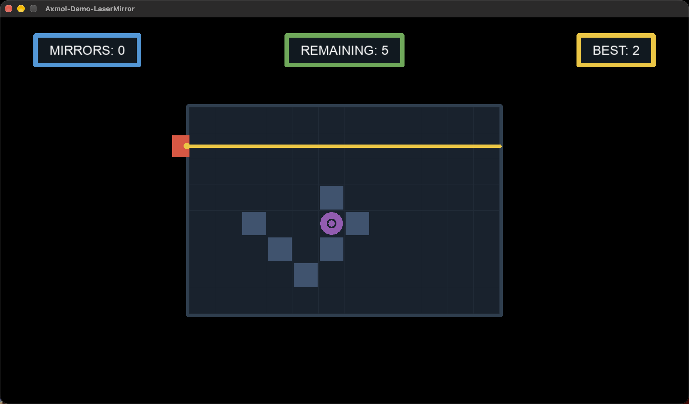

# Axmol Demo: Laser Mirror

[](LICENSE)

A small laser puzzle built with [Axmol Engine](https://axmol.dev/) and C++, written as a learning resource. You place mirrors to bend a laser beam into a target. The puzzle and its beam tracing are plain C++ with no engine dependency, so they can be read and tested on their own, and the views only draw what the puzzle tells them.



## Gameplay

- The laser is fired from the emitter on the left. Click a cell to place a **"/" mirror**, click it again to turn it into a **"\" mirror**, and click a third time to take it away.
- You can use at most **5 mirrors**. The boxes at the top show the mirrors used, the mirrors remaining and your best result.
- Walls stop the beam, and so does the target. The puzzle is solved when the beam reaches the target.
- The fewest mirrors you have used to solve it is saved as your best result. Press **Play again** to restart.

There are no image assets: everything is drawn with `DrawNode`.

## Requirements

* A C++ development environment
* [CMake](https://cmake.org/) 3.22 or later
* [Axmol Engine](https://github.com/axmolengine/axmol) 2.x and the platform tools it requires

Refer to the [Axmol documentation](https://axmol.dev/manual/latest/) for installation and platform setup.

## Build and run

Clone the repository, then use the Axmol command-line tools:

```bash
git clone https://github.com/theSlyest/Axmol-Demo-LaserMirror.git
cd Axmol-Demo-LaserMirror
axmol run -p osx -a arm64    # build and launch on Apple Silicon macOS
```

Change `-p` (and `-a`) for your platform, for example `-p win32` or `-p linux`. To build without launching, use `axmol build` with the same options. The platform project folders (`proj.android`, `proj.ios_mac`, `proj.linux`, `proj.wasm`, `proj.win32`, `proj.winrt`) come from the Axmol project template.

## How the code is organized

The scene only builds nodes and connects them. The puzzle knows nothing about nodes, and the views know nothing about the rules.

```
LaserMirrorScene        builds the nodes, wires everything, handles the touches
 ├─ LaserBoard          layout, mirrors and the beam trace (steps); solved or not
 ├─ BestScore           the best result, saved between runs
 ├─ LaserGrid           draws the board: the cells, the emitter, the mirrors and the beam
 │   └─ GridCell        a cell that shows a beam crossing it
 │       ├─ Mirror      ... and a mirror, when it holds one
 │       ├─ Wall        ... a block that stops the beam
 │       └─ Target      ... the goal, which lights up when the beam arrives
 ├─ LaserHud            mirrors used, mirrors remaining and best result
 └─ SolvedPanel         the result and a Play again button
```

When the player clicks, the scene asks `LaserGrid::cellAt` which cell was hit and tells `LaserBoard` to cycle it. The board traces the beam again, `LaserGrid::refresh` redraws the mirrors and the beam from that trace, and the scene updates the HUD and, if the board is solved, shows the panel.

### The beam is data

`LaserBoard` does not draw anything. It follows the beam from the emitter, cell by cell, and records each cell it crosses:

```cpp
struct BeamStep
{
    int row;
    int col;
    LaserSide from;               // the side the beam came in through
    std::optional<LaserSide> to;  // the side it leaves by (empty when the beam stops here)
};
```

An empty cell lets the beam straight through, a mirror turns it with a small reflection table, and a wall or the target ends it. The grid then draws each step. Because the trace is plain data, the rules can be tested without a window: the tests check every reflection, walls, the target, the mirror limit and the game's own puzzle.

### Try it: make your own puzzle

The level is a text grid, written from the top row down (`.` is empty, `#` is a wall and `T` is the target):

```cpp
static inline const std::vector<std::string> LEVEL {
    "............",
    "............",
    "............",
    ".....#......",
    "..#..T#.....",
    "...#.#......",
    "....#.......",
    "............",
};
```

The emitter and the mirror limit are constants next to it in `LaserMirrorScene.h`:

```cpp
static constexpr int INITIAL_MIRRORS = 5;
static constexpr LaserSide EMITTER_SIDE = LaserSide::LEFT;
static constexpr int EMITTER_POS = 6;   // the row (or the column, for the top and bottom)
```

For example, `EMITTER_SIDE = LaserSide::TOP` with `EMITTER_POS = 4` fires the beam down the fifth column. The saved best result is kept for the original puzzle, so you may want to clear it if you change the level.

## What this example shows

| Concept | Where |
| --- | --- |
| Scene setup, touch input and wiring the parts together | `LaserMirrorScene` |
| A puzzle and its beam tracing with no engine dependency | `LaserBoard` |
| A beam described as data (a list of steps) instead of drawing as it is traced | `LaserBoard::Beam` |
| A reflection table for the two mirror kinds | `LaserBoard::reflect` |
| A level written as readable text | `LaserMirrorScene::LEVEL` |
| Views that only draw the state they are given | `LaserGrid`, `GridCell`, `Mirror`, `Wall`, `Target` |
| Mapping a touch to a grid cell | `LaserGrid::cellAt` |
| Saving a result between runs, with the storage injectable for tests | `BestScore` |
| Procedural drawing with `DrawNode`, no image assets | `GridCell`, `Emitter`, `Target` |
| A button with `Menu` and `MenuItemLabel` | `SolvedPanel` |
| Unit tests with doctest | `Tests/` |

## Tests

`LaserBoard` and `BestScore` have no nodes, so they run in a plain test program. `Tests/` uses [doctest](https://github.com/doctest/doctest), which Axmol bundles:

- `LaserBoardTest`: how the layout is read, the beam going straight, stopped by a wall and ended by the target, entering from each side, reflected by both mirror kinds from every side and crossing a cell twice, the mirror cycle and limit, the cells that cannot hold a mirror, reset, and solving the game's real puzzle with two mirrors
- `BestScoreTest`: a record only when fewer mirrors are used, and only records are saved. The storage is a fake, so nothing real is touched.

Enable the test target when configuring, build it, and run the executable:

```bash
axmol build -p osx -a arm64 -f -xc '-D_AX_TESTS=ON'
cmake --build build --target Axmol-Demo-LaserMirror_test --config RelWithDebInfo
build/bin/Axmol-Demo-LaserMirror_test/RelWithDebInfo/Axmol-Demo-LaserMirror_test.app/Contents/MacOS/Axmol-Demo-LaserMirror_test
```

Pass `-D_AX_TESTS=OFF` when you are done to go back to building only the game.

## Source layout

- `Source/LaserMirrorScene.*`: creates the nodes, connects them, handles the touches and holds the level.
- `Source/LaserBoard.*`: the layout, the mirrors, the beam tracing and the solved state.
- `Source/BestScore.*`: the best result and the record rule, with the storage injected.
- `Source/LaserGrid.*`: draws a board and maps touches to cells.
- `Source/GridCell.*`, `Source/Mirror.*`, `Source/Wall.*`, `Source/Target.*`: the cells and how the beam looks in each.
- `Source/Emitter.*`: the laser emitter.
- `Source/LaserHud.*`, `Source/HudValue.*`: the three boxes at the top and the single box they use.
- `Source/SolvedPanel.*`: the result panel with its Play again button.
- `Tests/`: unit tests for `LaserBoard` and `BestScore`.

## Disclaimer

This project is intended for experimentation and education. It simplifies architecture, error handling and content in order to keep the concepts easy to follow.

## License

This repository is licensed under the MIT License. See the [LICENSE](LICENSE) file for details.

Third-party assets and dependencies may be subject to their own licenses.
